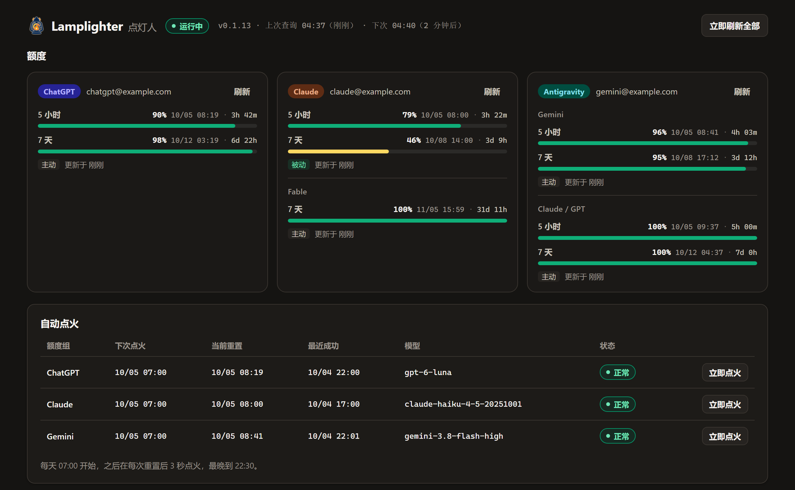
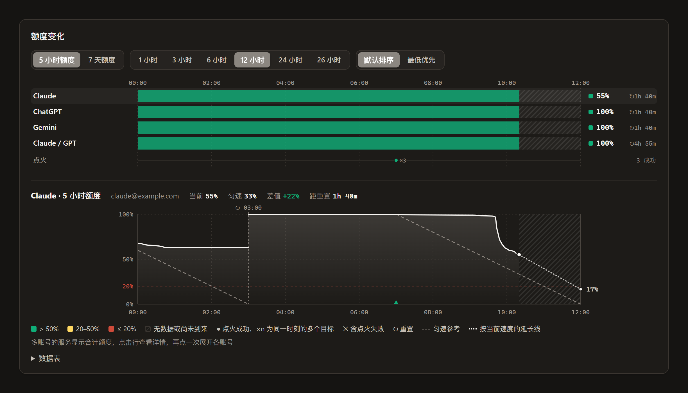
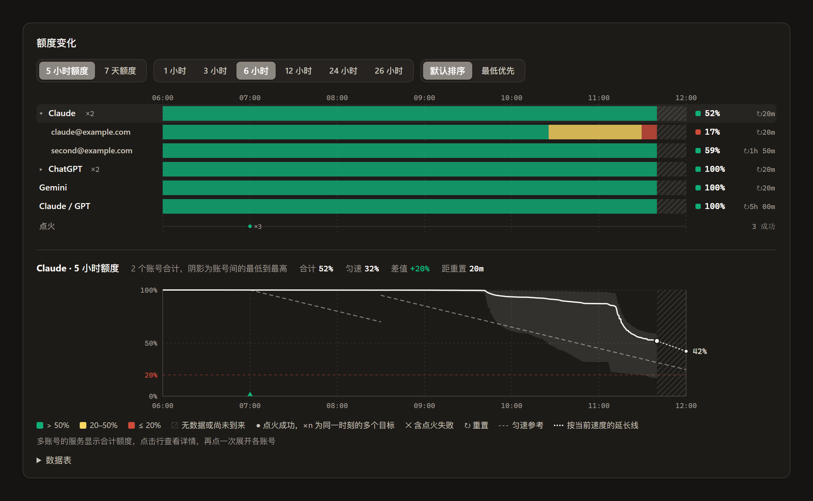

<p align="center"></p>

# Lamplighter

[English](./README_EN.md)

> 当他点燃路灯时，就像他又创造了一颗星星，或者一朵花——《小王子》
>
> 点灯人的星球每分钟转一圈，他就每分钟点一次灯、熄一次灯，从不误点。Lamplighter 做的也是按时点灯：每个 5 小时额度窗口一重置，就点亮下一个窗口。

Lamplighter（点灯人）是 [Magpie](https://github.com/yetone/magpie) 的插件，npm 包名为 `magpie-lamplighter`，在 Magpie 中显示为 **Lamplighter**。它监控 Magpie 中 ChatGPT（Codex）、Claude 和 Antigravity 订阅账号的额度，通过 [Bark](https://github.com/Finb/Bark) 或通用 webhook 推送提醒，并在 5 小时额度窗口重置后经 Magpie 发送一个极小的请求，让下一个窗口立即开始计时。编码 Agent 可以通过 MCP 查询额度。







## 功能

- **额度监控**：定时直接向厂商查询各账号的额度，同时读取 Magpie 转发请求时记下的额度。
- **图表**：每个账号一张额度卡；额度变化图表显示各窗口的历史曲线、匀速参考线、按当前速度的延长线和点火结果，多账号的服务显示按权重计算的合计。
- **通知**：通过 Bark 或 webhook（飞书、ntfy、钉钉、Telegram 等）推送。剩余额度降到 50%、20%、10% 和耗尽时提醒，账号套餐变化（例如会员到期）时提醒；可选的恢复通知和重置前提醒；可选转发 [Did Codex Reset](https://didcodexreset.com/zh.html) 的重置信号。
- **自动点火**（默认关闭）：每天 07:00 起，在每次 5 小时窗口重置后 3 秒发送最小请求，最晚到 22:30。请求经 Magpie 网关发送，并锁定到指定账号。
- **MCP**：编码 Agent 可以查询当前额度、历史和事件，并刷新额度。

| 服务 | Magpie 中的来源 | 监控范围 | 自动点火 |
| --- | --- | --- | --- |
| ChatGPT / Codex | Magpie 的 Codex 账号 | 5 小时、7 天 | 支持 |
| Claude | Magpie 的 Claude 账号 | 5 小时、7 天，以及 Fable 等单独计算的额度 | 支持，只点 5 小时窗口 |
| Antigravity | agy-cli 插件（`@magpie-community/opencode-agy-cli-auth`）的账号 | Gemini、Claude / GPT 等额度组 | 默认不点；开启后默认只点 Gemini |

Lamplighter 只监控 Magpie 中服务为 `codex`、`claude` 和 `agy-cli` 的订阅账号。Magpie 自带的 Antigravity 账号（服务为 `antigravity`）读不到凭证，不监控；需要监控 Antigravity 时，经 agy-cli 插件添加账号。没有 5 小时窗口的账号（例如 ChatGPT Pro）只监控其他窗口，不点火。Magpie 中的 API key 没有额度窗口，不显示。

### 账号名称

通知和页面中，ChatGPT 账号的额度组名为 `GPT`，与 Claude 的首字母不同，便于区分。同一服务有多个账号时，通知和页面用邮箱用户名的最后两个字符区分，例如 `GPT#rk`。账号有名称时改用名称，例如 `GPT#主力号`：在 Lamplighter 的“设置”视图中，进入“账号”区填写“名称”；没有填写时使用在 Magpie 中为账号改过的名称；Magpie 默认显示的邮箱或“邮箱 · 工作区”（如 `a@b.com · Team`）不算名称。名称保存在 Lamplighter 的设置中，不修改 Magpie 中的账号名称。名称取第一行，超过 20 个字时截断；只有一个账号的服务也显示名称；名称与同一服务另一个账号的名称或邮箱后缀相同时，名称后再加邮箱后缀。已记录的事件保留原来的标签。

### 多账号权重

同一服务有多个账号时，图表中的合计按权重平均各账号的剩余额度，权重表示账号的额度是该服务最便宜付费套餐的几倍。默认权重按识别到的套餐确定，账号卡片底部显示套餐名；ChatGPT 的套餐取自额度查询的结果；Claude 和 Antigravity 的套餐每个账号每天读取一次账号资料，账号返回的额度窗口有增减时立即重读，例如 Google AI Pro 到期后 Gemini 的 5 小时窗口消失时。读取失败时沿用上次读到的套餐，从未读到时权重为 1。在“设置”视图的“账号”区填写“权重”可以手动设置，可带小数，留空则恢复输入框中提示的套餐默认值；手动设置的权重保存在 `account_weights` 中，优先于默认值。权重不是 1 时，账号标题后显示倍数，例如 `×5`。

| 服务 | 套餐 | 默认权重 |
| --- | --- | --- |
| ChatGPT | Free、Go | 0.1 |
| ChatGPT | Plus、Business、Enterprise、Edu | 1 |
| ChatGPT | Pro $100、Business Premium | 5 |
| ChatGPT | Pro $200 | 10 |
| ChatGPT | Pro $500 | 25 |
| Claude | Pro、Team、Enterprise | 1 |
| Claude | Max 5x | 5 |
| Claude | Max 20x | 20 |
| Antigravity | Free、Pro、Ultra | 1 |

未识别的套餐默认权重为 1。

账号的套餐变化时（例如 Google AI Pro 到期或续订），插件推送一条 🎫 通知，例如 `🎫 Antigravity · 套餐 Pro → Free`。之后这个账号的额度提醒按新套餐的额度重新开始：新套餐的额度只记录，不当作额度恢复或下降来提醒。第一次读到套餐时只记录，不推送。Claude 的套餐每天读取一次，套餐变化后、读到新套餐之前，额度提醒仍按旧套餐的额度比较。套餐比额度窗口晚变化，或读取套餐连续失败超过 1 小时时，同样会按旧套餐的额度比较，可能发出一条错误的恢复或下降提醒。

## 要求

- Magpie v0.1.4634 或更新版本。更早的版本可能没有 Lamplighter 读取账号列表所用的接口，例如 v0.1.4479 读不到账号。
- 桌面版、`magpie web` 和 Docker 部署都可以使用。插件带有 Linux、macOS 和 Windows 的 amd64、arm64 程序，安装时不需要另外下载。
- 需要监控 Antigravity 时，在 Magpie 中安装 agy-cli 插件并添加账号。
- 需要通知时，一台装有 Bark 的 iPhone，或者一个能接收 webhook 的服务。

## 安装

在 Magpie 的“插件”页面打开“发现”，在“已有想装的？”输入框中填写 `magpie-lamplighter`，点击“安装”。也可以使用命令行：

```sh
magpie plugin add magpie-lamplighter
```

Docker 部署时在容器中运行这条命令，例如容器名为 `magpie` 时：

```sh
docker exec magpie magpie plugin add magpie-lamplighter
```

Magpie 读不到社区插件列表时，这条命令会报错，可以改用 `magpie plugin add npm:magpie-lamplighter`，直接按 npm 包名安装。

安装后，侧边栏的“插件”分组中出现 **Lamplighter** 页面。打开它即可启动插件；插件启动约 5 秒后开始第一次查询。

新安装的插件不自动点火。开启前依次完成：

1. 在“设置”视图的“时区”区设置时区，点“保存”。点火时段和页面、通知中的时间都按这个时区计算。没有保存过时区时，输入框中预填浏览器的时区，但不会自动保存。
2. 关闭 Magpie 自带的预热，见[与 Magpie 预热的冲突](#与-magpie-预热的冲突)。
3. 在“设置”视图的“自动点火”区勾选“启用自动点火”。

### 插件选项

插件只有一个选项 `port`：内部监听的端口，默认 `8317`。Magpie 的插件页面和 tool 都经这个端口访问 Lamplighter。端口被其他程序占用时（见[端口](#端口)），在 Magpie 的“插件”页面中打开“已安装”，点击 Lamplighter 一行的“选项”，填写：

```json
{"port": 8320}
```

也可以使用命令行：

```sh
magpie plugin options magpie-lamplighter '{"port": 8320}'
```

### 更新

插件每 6 小时检查一次新版本，打开管理页面时也检查一次。有新版本时，页面标题栏的版本号右边出现更新图标，指向发布说明。在 Magpie 的“插件”页面中更新，或运行 `magpie plugin update`。

### 数据目录

插件的配置（`config.json`）、状态和额度历史保存在以下目录中：

| 环境 | 目录 |
| --- | --- |
| Magpie 的 Docker 镜像 | `/config/state/lamplighter`，位于 `/config` 卷中，升级 Magpie 或重建容器后保留 |
| Linux、macOS | `$XDG_STATE_HOME/lamplighter`，没有设置 `XDG_STATE_HOME` 时为 `~/.local/state/lamplighter` |
| Windows | `%LOCALAPPDATA%\lamplighter` |

其他取值规则见[进程和数据目录](./docs/architecture.md#进程和数据目录)。

### CPA 版用户

Lamplighter 原先是 [CLIProxyAPI](https://github.com/router-for-me/CLIProxyAPI)（CPA）的插件，仓库为 [PosvdM/cpa-plugin-lamplighter](https://github.com/PosvdM/cpa-plugin-lamplighter)。改用 Magpie 后安装本插件即可。本插件不读取 CPA 版的配置和历史数据，设置需要重新填写。两者在同一台机器上运行时注意[端口](#端口)。

## 管理页面

页面有两种打开方式：

- **在 Magpie 中**：打开侧边栏“插件”分组中的 **Lamplighter**。桌面版和 `magpie web` 都可以使用，不需要密钥。页面的语言、深浅主题、配色和字体跟随 Magpie。Magpie 的插件页面不能打开外部链接：事件中的“申诉”和版本号旁的更新图标点击后显示网址，复制到浏览器中打开；标题不链接到 GitHub。
- **从外部直接访问**：开启对外监听，经反向代理从其他设备访问，见下文“对外访问”。

### 对外访问

对外监听让其他设备通过浏览器或 MCP 访问 Lamplighter，在“设置”视图的“高级”中设置：

| 配置项 | 默认值 | 说明 |
| --- | --- | --- |
| `public_listen` | `127.0.0.1:8318` | 对外监听地址 |
| `web_enabled` | `false` | 在对外监听上提供页面和接口，需要 `admin_key` |
| `admin_key` | 空 | 管理密钥；开启 `web_enabled` 时没有密钥，页面会生成一个 |
| `mcp_enabled` | `false` | 在对外监听上提供 `/mcp`，见 [MCP](#mcp) |
| `mcp_key` | 空 | MCP 专用密钥；开启 `mcp_enabled` 时没有密钥，页面会生成一个 |

页面和 MCP 都关闭时不监听。两把密钥互不通用：管理密钥不能访问 `/mcp`，MCP 密钥不能访问页面和接口。两把密钥不能相同，保存相同的密钥时页面报错；手动编辑 `config.json` 写入相同的密钥时，对外监听不提供页面、接口和 `/mcp`，页面顶部显示原因。

经对外地址第一次打开页面时，页面提示“需要管理密钥”，输入后保存在当前浏览器中。管理密钥在别处被替换后，已打开的页面会重新加载并再次提示输入。打码、图表的选择等页面选项保存在 Lamplighter 的配置中，各设备共用（在普通浏览器中开过打码的，升级后第一次打开页面时会把打码存进配置，之后所有设备共用）；“额度 | 设置”上次打开的视图按浏览器分别保存。

不建议直接监听公网。保持对外监听在回环地址上，由同机的反向代理终止 TLS，并按需增加防火墙或访问白名单。代理需要保留 `Authorization` 和 `MCP-Protocol-Version` 请求头；`/mcp` 拒绝带非本机 `Origin` 的浏览器请求，普通 MCP Agent 通常不发送这个头。

Docker 部署时，对外监听位于容器内。把 `public_listen` 设为 `0.0.0.0:8318`，创建容器时发布这个端口（例如 `-p 127.0.0.1:8318:8318`），再由宿主机上的反向代理转发。

Nginx 示例（替换域名和证书路径）：

```nginx
server {
    listen 443 ssl;
    server_name quotas.example.com;
    ssl_certificate /etc/letsencrypt/live/quotas.example.com/fullchain.pem;
    ssl_certificate_key /etc/letsencrypt/live/quotas.example.com/privkey.pem;
    location / {
        proxy_pass http://127.0.0.1:8318;
        proxy_set_header Authorization $http_authorization;
        proxy_set_header MCP-Protocol-Version $http_mcp_protocol_version;
        proxy_read_timeout 190s;
    }
}
```

Caddy 示例（域名解析到代理，Caddy 自动申请 HTTPS 证书）：

```caddyfile
quotas.example.com {
    reverse_proxy 127.0.0.1:8318 {
        transport http {
            response_header_timeout 190s
        }
    }
}
```

鉴权和监听的细节见[对外监听](./docs/architecture.md#对外监听)。

### 页面内容

页面顶部通过“额度 | 设置”切换视图，浏览器记住上次打开的视图。“额度”视图包含：

- 各账号的额度窗口、重置时间（带星期几）、数据来源和套餐，可以单独刷新某个账号；
- 页面中的时间按“设置”视图中的时区显示；没有设置时区时按浏览器的时区显示，并在“额度”视图顶部提示：这时点火时段和通知中的时间按服务器的时区计算；
- 额度条和图表共用五档颜色：原始剩余值为 100% 时为“满”，0% 时为“空”，中间按前两档提醒阈值分为“高”“中”“低”；99.6% 即使显示为 100% 也不按满额着色；
- 每个额度组的下次点火时间和当前重置时间（均带星期几）、最近一次结果和失败保护状态，可以立即点火；关闭自动点火时不显示这部分；
- 额度变化图表：
  - 先选 5 小时或 7 天额度。5 小时额度可看 1、3、6、12、24、26 小时（默认 6 小时），7 天额度可看 1、4、8、15 天、1 个月（上月这一天起）和 36 天（默认 8 天）。其他长度的窗口只在账号卡片上显示。开启 `remember_chart_filters`（“记住额度窗口、时间范围和排序”）后，页面记住上次的选择，各设备共用。
  - 1、3 小时和 1、4 天显示到现在为止。更长的范围以所选行当前窗口的重置时间为右端，例如 6 小时显示当前 5 小时窗口和上个窗口的最后 1 小时；现在之后的部分画成斜纹。
  - 上半部分每个服务一行色带，颜色与额度条相同，按每个周期内的最低读数着色。默认跟随账号卡片顺序，也可按剩余最低排序；同一服务有多个账号时显示按权重计算的合计，选中后再点一次可展开各账号；开启 `remember_chart_expanded`（“记住展开的分组”）后，页面记住展开的分组，5 小时和 7 天额度共用一套。某个账号暂时缺数据时，合计按它前后的读数估算这个账号的值，详情图中这一段画成虚线，最新的合计是估算值时不画延长线。账号不再报告的窗口标为“已停用”，保留到最后一个样本移出所选范围。
  - 下半部分是所选行的曲线，标出重置时刻和点火结果，并画出匀速参考线：以 5 小时或 7 天为周期，从 100% 线性降到预定重置时的 0%。曲线在线上方说明用得比匀速慢。曲线上方显示当前剩余、此刻的匀速参考值和两者的差值。
  - 右端是重置时间时，从现在画一条延长线：先用完时在时间轴上标出用完的时间，先到重置时在图表右侧标出届时的剩余额度。5 小时额度按当前速度延伸，刚开始大量使用的几分钟内，估计的用完时间偏早；7 天额度按本周期的日均用量延伸，周期刚开始的一两天偏差较大。
  - 页面每 30 秒读取一次状态，有新数据时更新图表；鼠标停在图表上时，等移开后再更新。
  - 一个账号有多个额度组时（如 Antigravity 的“Gemini”和“Claude / GPT”），图表、数据表、自动点火表和事件中的额度组名前加上服务名，如“Antigravity · Claude / GPT”，图表左侧放不下时缩写为“AG · Claude / GPT”；额度组名就是服务名时（如 Claude 账号的主额度组“Claude”）不加；账号卡片中的额度组已在服务标签下方，不加。凭证失效等账号级事件的标签本来就是账号名，不再加服务名。
- 最近的事件，按时间、类型、额度组和详情分列显示，额度组一列按最长的名称调整宽度。由某个事件触发的推送在该事件行尾标出“已推送”或“推送失败”。5 小时额度的重置默认隐藏，勾选“显示 5 小时重置”后显示，页面记住这个选择。

图表的计算方法见[页面功能](./docs/architecture.md#页面功能)。

页顶、卡片区标题栏和曲线详情标题栏的眼睛按钮共用“打码账号”和“显示账号”开关。打码会模糊账号名称、邮箱和“账号”区的输入框（“Claude#rk”这类名称只模糊后缀，服务名照常显示），以及事件和历史图表中保留的旧账号名称；上游错误等可能提到账号的文字整体模糊。打码状态保存在 Lamplighter 的配置中，各设备共用；打开页面时，读到配置之前只显示“加载中…”，不显示页面内容，读取失败时显示原因和“重试”按钮。打码只影响显示，不删除接口或页面中的原始数据。

账号卡片、卡片区标题栏和曲线详情标题栏的相机按钮，分别将单张卡片、全部卡片和详情图复制为 PNG 图片。截图保留当前主题和打码状态，不包含操作按钮。在 Magpie 中，图片交给 Magpie 写入剪贴板；单独在浏览器中打开时，需要浏览器支持图片剪贴板，并在 HTTPS 或 localhost 等安全上下文中获得剪贴板权限。

“设置”视图依次为“账号”“通知渠道”“提醒规则”“时区”“自动点火”“服务”和“高级”。开关和勾选框点击后自动保存，文本和数字在离开输入框或按回车时自动保存，保存结果显示在区块标题右侧。保存后显示“已保存，等待生效”，插件确认后显示“已生效”，15 秒内未确认则显示“未确认生效”。保存失败时，标题显示字段名和原因，失败的控件标红，输入草稿保留。“账号”区可以修改名称和权重，并通过拖动手柄调整账号顺序（保存为 `account_order`），拖动时按 Esc 取消。“通知渠道”中的“测试推送”在设置生效后向所有已配置的渠道发送，并逐个显示结果。

“服务”区勾选要监控的服务。服务有多个额度组时（如 Antigravity 的“Gemini”和“Claude / GPT”，或报告了 Fable 的 Claude 账号），服务下方列出“显示的额度组”，默认全部勾选；只有一个额度组的服务不显示这一排，但这个额度组被隐藏时仍显示，以便重新勾选，例如手动写进了 `hidden_groups`，或者在页面上隐藏后服务只剩这一个额度组。取消勾选可以隐藏不关心的额度组，例如一直是 100% 的“Claude / GPT”，保存在 `hidden_groups` 中，对这个服务的所有账号生效：

- 账号卡片中不显示这个额度组；一个账号的额度组都被隐藏时，整张卡片不显示。
- 额度变化图表的各行、合计、详情图和数据表都不包含它，“最低优先”排序也不计入它；只有它报告的窗口种类（例如只有它有 7 天窗口）不出现在图表的标签页中。账号被删除，或它的服务在“服务”区取消监控后，历史中只剩内部标识，认不出额度组，所以这部分曲线照常显示，这种窗口的标签页也可能因此保留。
- 不推送它的额度通知（额度下降、耗尽、恢复和重置前提醒），隐藏期间到期的提醒在重新显示后也不补发；隐藏之前已经到期、还没发出的提醒在重新显示后发出。勾选的变化在设置生效后立即显示在页面上；通知从下一次按新设置进行的查询起生效，保存时正在进行的查询仍按原来的设置判断。凭证失效、套餐变化等账号级通知和 Did Codex Reset 不受影响。
- 插件照常查询和记录它的额度，重新勾选后图表是连续的；事件列表、自动点火表和 MCP 工具的返回不变。

## 额度获取

**主动查询**：默认每 5 分钟一次，固定在每小时的 `00 / 05 / 10 / ... / 55` 分钟。此外，每个额度窗口重置前 30 秒和重置后 30 秒，插件各对这个账号再查询一次：前一次记录这个周期最后的剩余额度，后一次确认新周期并及时发出恢复通知。这段时间里已有新读数时不再查询。查询直接发给厂商的额度接口，不经过 Magpie 网关，也不经过 Claude Code。

**Magpie 的额度记录**：Magpie 转发请求时会记下各账号的额度，插件每 60 秒读取一次，不额外向厂商发请求。Codex 和 Claude 有这类数据，Antigravity 只能主动查询。某个账号在整点前 60 秒内刚有过新读数时，这一轮跳过对它的主动查询；同一账号最多连续跳过 30 分钟，到时一定主动查询一次。

**凭证**：插件从 Magpie 的配置目录读取各账号的 token，只在内存中使用。Claude 和 Codex 的 token 只读取、不刷新：这两个服务刷新 token 时会更换 refresh token，插件刷新后 Magpie 或代理 CLI 手中的 token 就会失效，账号随之掉线。这两个服务的 token 过期、还没有被 Magpie 刷新时，插件不向厂商查询，改用 Magpie 记下的最近读数；手动刷新（页面的刷新按钮或 MCP 的 `refresh_quotas`）时，插件先让 Magpie 重新读取这个账号的额度；定时查询时每个账号每 30 分钟最多让 Magpie 重新读取一次（Claude 的 setup-token 除外）。Claude 的重新读取会运行一次 Claude Code，同时更新 token，所以空闲的 Claude 账号大约每 8 小时运行一次 Claude Code。刷新单个账号失败时，页面和 `refresh_quotas` 给出原因，例如账号在 Magpie 中已关闭、Magpie 中找不到这个账号或 Magpie 网关不可用；Magpie 这次没有读到新额度时，页面显示 Magpie 记下的旧读数，刷新仍报告失败，原因以“Magpie 这次没有读到新额度”开头；`refresh_quotas` 不返回上游的错误原文，其他错误提示用 `list_quotas` 查看各账号的状态。Antigravity 的 token 由插件自己在内存中刷新，不写回文件。具体规则见[凭证](./docs/architecture.md#凭证)和[额度记录](./docs/architecture.md#额度记录)。

**网络出口**：主动查询和 Magpie 对同一账号的请求使用同一个出口：Magpie 中为该账号或该服务设置的代理，其次是 Magpie 的全局代理，再次是 Magpie 使用的系统代理，都没有时直连。代理无法解析时，插件跳过这次查询，不改用直连。见[网络出口](./docs/architecture.md#网络出口)。

Claude 和 Codex 的额度精确到 1%，Antigravity 的额度带小数。窗口在套餐升级时消失、降级后重新出现时，首次读数只记录新的提醒基线，不发送恢复通知或重置前提醒；窗口消失不通知，历史记录保留消失的窗口。

## 自动点火

5 小时额度窗口从重置后的第一个请求开始计时。重置后没人使用时，窗口不会开始。开启自动点火后，Lamplighter 在每次重置后立即发一个请求，让窗口连续滚动。点火规则如下：

- 时间按“设置”视图中设置的时区计算，不受 Magpie 所在服务器时区的影响。没有设置时区时使用程序所在系统的时区，Magpie 的 Docker 镜像为 UTC；页面中的时间这时按浏览器的时区显示，“额度”视图顶部提示尚未设置时区。
- 每天 `07:00` 第一次点火，之后在每次重置后 3 秒点火，最晚到 `22:30`。晚于这个时间的重置顺延到第二天 07:00。
- 请求经 Magpie 网关发送，用请求头锁定到这个账号，网关不会改用其他账号。Claude 的请求在 Magpie 中由 Claude Code 转发，带有 Claude Code 自己的系统提示词，输入 token 比直接请求多。
- 请求只要求模型回复 `OK`，不带工具。收到首次输出后 2 秒关闭请求；每个候选模型的请求从发出到结束最长 2 分钟；网关返回错误状态码时，读取错误内容另有最多 10 秒。换用下一个候选模型和之后的确认另计时间，所以一次点火可能更久。
- 点火模型自动选择：ChatGPT 用最新的 Luna，Claude 用最新的 Haiku，Antigravity 的 Gemini 组用最新的 Flash。Magpie 列出新模型后，下一次点火就会使用它；账号不能使用这个模型时，这次点火改用下一个候选模型，被上游拒绝的模型 24 小时内不再尝试。也可以在配置中指定。
- 请求发出后，插件确认 5 小时窗口有了一个固定的未来重置时间，才算点火成功。Magpie 网关不转发 Codex 的额度响应头，Codex 和 Antigravity 的点火靠之后几次主动查询确认：分多次确认，间隔合计约 75 秒，另计每次查询的耗时。

每次点火的模型、回复、usage 和耗时写入 Magpie 的日志，见[调用日志](./docs/architecture.md#调用日志)。

### 与 Magpie 预热的冲突

Magpie 自带的预热（内置插件“预热与签到”）也会在窗口重置后或设定的时间点发送请求，开启 Codex 和 Claude 的 5 小时窗口。它与 Lamplighter 的自动点火同时开启会重复点火。Lamplighter 开启点火、Magpie 也为同一账号开启了 5 小时窗口的预热时，页面顶部列出这些账号；请在 Magpie 中关闭它们的预热。只在 7 天窗口重置时预热的设置不冲突。

### 失败保护

以下重试和暂停规则用于自动点火。“立即点火”失败时只显示错误并记录事件，不自动重试、不计入失败次数，也不改变已有自动点火计划；成功时照常记录。

- 凭证失效（401 等）或账号被停用（例如 Google 返回 `TOS_VIOLATION`）时，这个账号停止自动点火，不再每天重试，推送一次 🔑 或 ⛔ 通知（停用通知附申诉链接）。在 Magpie 中重新登录后自动恢复；“立即点火”成功也会恢复。额度查询持续认证失败（连续 3 次、30 分钟以上）或发现账号停用时同样提醒；同一个问题只提醒一次，插件重启后也不重复。问题解除时推送 ✅ 凭证已恢复。
- 厂商限流（429）、模型不可用，或请求成功但窗口没有开始，都会让这个额度组停止点火到第二天 07:00，并推送一次通知；限流的通知为 ⏳ 被限流。通知只写上游错误的第一句话，完整错误在页面的事件详情中。
- 网络错误和服务端错误先在 5 分钟、15 分钟后重试；第三次仍失败，同样停到第二天。
- Magpie 在账号被限流或额度用完后让它休息到厂商的重置时间。点火撞上这段休息、且休息在 10 分钟内结束时，等休息结束后重试，不算失败。
- 同一账号的 7 天额度（或其他非 5 小时窗口）用完时，这个额度组不再自动点火，等到该窗口重置、查询看到额度恢复后继续；页面状态显示“7 天额度已用完”。“立即点火”不受影响。

分类规则见[失败分类和保护](./docs/architecture.md#失败分类和保护)。

## 通知示例

通知使用最近一次打开管理页面时页面的语言（中文或英文，跟随 Magpie），从没打开过时使用中文。

```text
🟡 Claude · 7d 48% | 03d

5h：96% | 04h | 10/04 周日 13:50
7d：48% | 03d | 10/07 周三 14:00
```

标题前的图标：🟡 剩余降到第一档（默认 50%），🔴 降到第二档（默认 20%）及以下，✅ 额度恢复，⏰ 重置提醒，🎫 套餐变化，🔑 凭证失效，⛔ 账号已停用，⏳ 被限流，✅ 凭证已恢复，⚠️ 点火暂停等需要处理的问题。正文每行依次是：窗口、剩余额度、距离重置的时间、重置时间。通知中的日期时间都写成“月/日 星期 时:分”，英文通知如 `10/04 Sun 13:50`。第一次看到某个额度窗口时只记录当前状态，不推送。

## 配置

配置保存在[数据目录](#数据目录)的 `config.json` 中，通常在管理页面的“设置”视图中修改，保存后立即生效，不需要重启。插件运行时只在启动时读取这个文件，之后以页面保存的内容覆盖它。如需手动编辑，先在 Magpie 的“插件”页面停用 Lamplighter，编辑后再启用，然后打开一次页面。

| 配置项 | 默认值 | 说明 |
| --- | --- | --- |
| `bark_url` | 空 | Bark 推送地址，写到 device key 为止；为空时不通过 Bark 推送 |
| `bark_group` | `Magpie` | Bark 通知分组 |
| `bark_icon` | Lamplighter 图标 | 通知图标 |
| `webhook` | 空 | 通用 webhook，见 [Webhook](#webhook) |
| `notice_threshold` | `50` | 第一档提醒阈值（剩余百分比） |
| `low_threshold` | `20` | 第二档提醒阈值 |
| `critical_threshold` | `10` | 第三档提醒阈值 |
| `recovery_notify` | 5 小时 `after_exhausted`，7 天 `all` | 额度恢复时通知，见下文 |
| `reset_reminder` | 5 小时 `off`，7 天 `has_remaining` | 重置前提醒，见下文 |
| `reset_reminder_hours` | 5 小时 `[1]`，7 天 `[24]` | 重置前提醒提前多少小时，见下文 |
| `timezone` | 空 | 显示时间和点火时段使用的时区，IANA 名称，如 `Asia/Shanghai`；为空时点火和通知使用程序所在系统的时区（Magpie 的 Docker 镜像为 UTC），页面按浏览器的时区显示时间。要跟随系统的时区时留空，`Local` 视为无效的名称。保存时校验，无效的名称不保存；手动写入无效的名称时，插件启动时记一条警告，按留空处理 |
| `timezone_offset_hours` | 空 | 固定的 UTC 偏移，例如 `8`；只在 `timezone` 为空时使用 |
| `poll_interval_seconds` | `300` | 主动查询间隔，最小 60 |
| `request_timeout_seconds` | `20` | 额度查询、通知等 HTTP 请求的超时，5～120；不限制点火 |
| `passive_skip_seconds` | `60` | 整点前多少秒内有 Magpie 的新读数时跳过主动查询；`0` 表示不跳过 |
| `passive_skip_max_minutes` | `30` | 同一账号最多连续跳过多少分钟 |
| `history_retention_days` | `40` | 额度历史保留天数 |
| `remember_chart_filters` | `false` | 记住“额度变化”上次选择的额度窗口、时间范围和排序，存在 `chart_view` 中，各设备共用 |
| `remember_chart_expanded` | `false` | 记住“额度变化”中展开的多账号分组，存在 `chart_expanded` 中，各设备共用 |
| `chart_view`、`chart_expanded` | 空 | 页面自动写入：开启上面两项时所选的窗口、排序和各窗口的时间范围，以及展开的分组标识（服务和名称，如 `claude\|Claude`）；关闭时删除，对应开关关闭期间也不保存 |
| `mask_accounts` | `false` | 页面自动写入：打码开关的状态 |
| `events_show_5h_resets` | `false` | 页面自动写入：事件列表的“显示 5 小时重置” |
| `hidden_groups` | 空 | 隐藏的额度组，元素为“服务标识\|额度组名”，如 `["antigravity\|Claude / GPT"]`；在“服务”区的“显示的额度组”中设置，见[页面内容](#页面内容)。插件读取时去掉各项首尾的空白、空项和重复项；保存这一项时（包括在页面上勾选）按同样的规则写入文件，为空时删除这个键。只修改其他设置时，文件中手动写入的这一项保持原样 |
| `account_names` | 空 | 账号名称，键为账号在 Magpie 中的标识（如 `codex/<id>`） |
| `account_weights` | 空 | 多账号合计中各账号的权重，键同上，值为大于 0 的数字；未设置的账号使用套餐的默认权重 |
| `account_order` | 空 | 账号顺序，按账号标识排列；未列出的账号按默认顺序排在后面 |
| `public_listen`、`web_enabled`、`admin_key`、`mcp_enabled`、`mcp_key` | | 见[对外访问](#对外访问) |
| `mcp_public_url` | 空 | MCP 的对外地址，例如反向代理的 HTTPS 地址，页面的客户端配置用它；只接受 http 或 https 地址，没写协议时按 `https://` 处理，形式为 `主机[:端口][/路径]`；主机名只能含 ASCII 字母、数字、`.` 和 `-`，不支持方括号中的 IPv6 地址；整个地址只能含可打印 ASCII 字符，不能含空格、`?`、`#`、`\` 或用户名；为空时用对外监听地址，见 [MCP](#mcp) |
| `config_token` | 空 | 页面保存设置时生成的确认令牌，不需要手动设置；只保存页面状态（上面页面自动写入的各项、两个“记住”开关和 `mcp_public_url`）时不更新，插件也不重新应用配置 |

提醒阈值按 `100 ≥ notice_threshold ≥ low_threshold ≥ critical_threshold ≥ 0` 规整，后两档不能高于前一档。

`bark_url` 和 `webhook.url` 都为空时通知关闭：不发送任何通知，也不在事件中记录推送失败。之后再填上地址，关闭期间的额度提醒不会补发。`hidden_groups` 中的额度组同样不推送额度通知，见[页面内容](#页面内容)。

恢复通知和重置前提醒按窗口分别设置，`five_hour` 对应 5 小时窗口，`seven_day` 对应 7 天窗口：

| 配置项 | 取值 | 说明 |
| --- | --- | --- |
| `recovery_notify` | `off`、`all`、`after_exhausted` | `all`：窗口每次重置都通知；`after_exhausted`：窗口用完后，只在下一次重置时通知一次 |
| `reset_reminder` | `off`、`all`、`has_remaining` | `all`：每个提前时间都提醒；`has_remaining`：只在提醒时剩余高于 `critical_threshold` 才提醒 |
| `reset_reminder_hours` | 小时数的数组，可为小数 | 在重置前多少小时提醒。5 小时窗口取 0.5～4.5，7 天窗口取 1～167，超出范围的值按最近的边界处理；重复的值合并，每个窗口最多 3 个，多于 3 个时取最大的 3 个；空数组恢复默认值 |

重置前提醒在每个提前时间各发一次，每个重置周期一次。例如 7 天窗口设为 `[24, 10]` 时，在重置前 24 小时和 10 小时各提醒一次。提醒在越过提前时间之后的第一次查询时发出，默认每 5 分钟查询一次，所以通常最多晚一个查询间隔；插件刚启动或第一次看到窗口时可能更晚。一次查询同时越过多个提前时间时只发一条提醒，例如插件停止了一段时间，或者新加的提前时间已经过了。第一次看到某个窗口时只记录当前状态，不发重置前提醒；下一次读数已在重置之后时，这个周期就不提醒。删掉一个提前时间不会让本周期已发过的提醒再发一次。在“设置”视图的“提醒规则”中，“提前（小时）”一行按窗口填写，多个值用逗号分隔，如 `24, 10`。

恢复通知的第一行是上一周期结束时的剩余额度。这个值来自重置前 30 秒的那次主动查询，最后 30 秒内的用量不计入。找不到重置前 15 分钟内的读数时不显示这一行。上一周期从没用过（重置前仍是 100%）时不通知。

点火相关设置在 `ignition` 下：

| 配置项 | 默认值 | 说明 |
| --- | --- | --- |
| `enabled` | `false` | 是否自动点火 |
| `start_hour` | `7` | 每天第一次点火的时间（时） |
| `end_hour` | `22` | 每天停止点火的时间（时） |
| `end_grace_minutes` | `30` | `end_hour` 之后再顺延的分钟数 |
| `grace_seconds` | `3` | 重置后延迟多少秒点火 |
| `failure_retry_seconds` | `300` | 临时错误后第一次重试的等待时间 |
| `failure_backoff_multiplier` | `3` | 每次重试等待时间的倍数 |
| `max_transient_failures` | `3` | 临时错误达到这个次数后停到第二天 |
| `post_success_hold_seconds` | `60` | 点火成功后至少等待多久才可能再次点火 |

各服务的设置在 `providers` 下，键名为 `codex`、`claude`、`antigravity`：

| 配置项 | 说明 |
| --- | --- |
| `monitor` | 是否监控，默认开启；关闭后这个服务也不点火 |
| `ignite` | 是否自动点火；`codex` 和 `claude` 默认开启，`antigravity` 默认关闭 |
| `model` | 指定点火模型，留空时自动选择；必须出现在 Magpie 中该服务的模型列表中，可以写模型名或带服务前缀的完整 ID，例如 `agy-cli/gemini-3-flash` |
| `groups` | 仅 Antigravity：允许点火的额度组，默认 `["Gemini"]`；空数组 `[]` 表示一个都不点，省略时使用默认值 |
| `models` | 仅 Antigravity：按额度组指定模型，例如 `{"Gemini": "gemini-3-flash"}` |

`codex_reset_updates` 控制 Did Codex Reset 转发：`enabled`（默认 `false`）、`poll_seconds`（默认 `300`，最小 300）、`notify_current_pending`（默认 `true`，第一次开启时推送当前尚未生效的排期）。只转发尚未到期的排期和 48 小时内的完成记录；同一次排期有多条帖子时，只在置信度、时间或范围变化时作为排期更新再推送。Did Codex Reset 是第三方监测站，它的信号不代表 OpenAI 官方确认。

示例：

```json
{
  "timezone": "Asia/Shanghai",
  "bark_url": "https://api.day.app/你的device_key",
  "ignition": {"enabled": true, "start_hour": 7, "end_hour": 22},
  "providers": {
    "antigravity": {"ignite": true, "groups": ["Gemini"]}
  },
  "codex_reset_updates": {"enabled": true}
}
```

`ignition`、`providers` 等对象按顶层键整体保存，在页面中修改时以已保存的对象为基础。

## MCP

MCP 让编码 Agent 查询额度。有两种接法：

| 接法 | 地址 | 鉴权 | 工具名 |
| --- | --- | --- | --- |
| Magpie 的插件 tool | Magpie 网关的 `/mcp/magpie/tools/magpie-lamplighter` | 与 Magpie 网关相同 | 带 `magpie-lamplighter_` 前缀，例如 `magpie-lamplighter_list_quotas` |
| 对外监听 | 对外监听的 `/mcp`，默认 `http://127.0.0.1:8318/mcp` | `mcp_key` | 不带前缀 |

### Magpie 的插件 tool

插件启用后，Magpie 把它的工具作为 MCP 服务提供，不需要在 Lamplighter 中开启任何设置。Magpie 的“插件”页面中，Lamplighter 一行列出这些工具，并可以复制 MCP 地址；Magpie 也会在“资源库”的 MCP 中添加名为 `magpie-lamplighter` 的服务，开启 MCP 路由时直接提供给 Agent。网关默认监听 `127.0.0.1:3425`，此时地址为：

```text
http://127.0.0.1:3425/mcp/magpie/tools/magpie-lamplighter
```

本机的请求不需要密钥；从其他机器或 Docker 容器外访问时，需要带 Magpie 的网关密钥。Magpie 给每次工具调用最多 55 秒，`refresh_quotas` 经这种接法最多等待约 50 秒。

### 对外监听的 /mcp

在“设置”视图的“高级”中勾选“启用 MCP 接口”；没有密钥时，页面在同一次保存中生成密钥，也可以单独生成新密钥。该区还给出 Claude Code、通用 JSON 和 mcp-remote 的客户端配置，其中的地址取“对外地址（可选）”中填写的地址（`mcp_public_url`），没有填写时取对外监听地址。远程使用时经 HTTPS 反向代理访问，见[对外访问](#对外访问)。

接口采用 Streamable HTTP，支持协议版本 `2025-03-26` 和 `2025-06-18`，只返回 JSON，不提供 SSE。每个服务实例最多同时执行 4 次工具调用，超出时立即返回 JSON-RPC `-32000` 忙碌错误，可稍后重试。查询工具超时为 10 秒，`refresh_quotas` 为 180 秒。协议细节见 [MCP](./docs/architecture.md#mcp)。

以下示例中的 `<key>` 是 MCP 专用密钥，远程连接时把地址换成 HTTPS 地址。

Claude Code：

```sh
claude mcp add --transport http lamplighter http://127.0.0.1:8318/mcp --header "Authorization: Bearer <key>"
```

Codex CLI（密钥通过环境变量提供）：

```sh
export LAMPLIGHTER_MCP_KEY='<key>'
codex mcp add lamplighter --url http://127.0.0.1:8318/mcp --bearer-token-env-var LAMPLIGHTER_MCP_KEY
```

通用客户端配置示例（字段格式以客户端文档为准）：

```json
{"mcpServers":{"lamplighter":{"type":"http","url":"http://127.0.0.1:8318/mcp","headers":{"Authorization":"Bearer <key>"}}}}
```

只支持 stdio 的客户端可以通过 `mcp-remote` 连接：

```sh
npx mcp-remote http://127.0.0.1:8318/mcp --header "Authorization: Bearer <key>"
```

### 工具

| 工具 | 用途 |
| --- | --- |
| `list_quotas(provider?, account?, model?)` | 当前窗口、各账号套餐和权重、加权剩余、最早耗尽账号、重置和预计耗尽时间、每小时消耗、7 天匀速预算、数据来源与新鲜度、凭证失效、账号停用及下次点火时间 |
| `get_quota_history(provider?, account?, window?, range?)` | 历史额度，包括已消失的窗口；每个系列最多 200 点，单次最多 2000 点 |
| `refresh_quotas(account?)` | 主动查询；全局每 60 秒最多一次，超限返回等待秒数；失败时返回 `ok: false` 和原因 |
| `get_quota_events(since?, limit?)` | 最近的重置、耗尽、点火成功和失败，以及凭证失效、账号停用、限流和凭证恢复；`since` 为带时区的 RFC 3339 时间，`limit` 为 1–100 的整数 |

工具返回的账号标识优先使用账号名称，其中的邮箱打码；没有名称时使用 `***` 加邮箱用户名的最后两个字符，例如 `***rk`。打码后相同的标识加上 `#1`、`#2` 等后缀。工具不返回完整邮箱，这一规则与页面的打码开关无关。`account` 参数接受返回的完整标识、加后缀前的基础标识、原始账号名称或完整邮箱，均为精确匹配；`refresh_quotas` 要求只匹配一个账号。

插件启动后先等约 5 秒，再执行第一轮查询。首轮完成前，读取工具返回 `ready: false`、`state: "starting"` 和 `retry_after_seconds: 30`，不返回数据。时间同时包含带时区的 ISO 时间和相对时间。预测取决于使用速度，不能保证准确。`model` 查询返回候选额度组并标记 `certain: false`：Magpie 在实际请求中按自己的规则选择账号，插件不能保证最终选中哪个账号。字段的含义见[工具数据](./docs/architecture.md#工具数据)。

## Webhook

除了 Bark，还可以配置一个 webhook，把通知发到飞书、ntfy、钉钉、Telegram 等服务或者自己的程序。两个渠道都配置时，每条通知同时发给两边；只要有一边发送成功就算送达，不再重试，失败的一边在事件中记为“推送失败”。

| 配置项 | 默认值 | 说明 |
| --- | --- | --- |
| `url` | 空 | 请求地址；为空时不启用 |
| `method` | `POST` | `GET`、`POST` 或 `PUT` |
| `headers` | 空 | 请求头，例如 `Authorization: Bearer <token>` |
| `body` | 空 | 请求体；为空时发送内置的 JSON 消息。`GET` 请求不能设置 |
| `success_json` | 空 | 成功条件：JSON 响应中这些顶层字段必须等于给定的值，例如 `{"code": 0}`；为空时只要求 HTTP 状态码为 2xx |

地址、请求头和请求体中可以使用占位符：

| 占位符 | 内容 |
| --- | --- |
| `{{title}}` | 通知标题 |
| `{{body}}` | 通知正文 |
| `{{text}}` | 标题和正文，中间换行 |
| `{{url}}` | 跳转链接：Did Codex Reset 通知为历史页面，账号停用通知为 https 申诉链接，其余为空 |
| `{{priority}}` | 额度降到第三档或耗尽、套餐变化、点火暂停、凭证失效、账号停用、被限流时为 `high`，其余为 `normal` |
| `{{kind}}` | 通知类型：`quota` 额度下降、`recovery` 额度恢复、`reminder` 重置提醒、`plan` 套餐变化、`circuit` 点火暂停、`credential` 凭证失效、`suspended` 账号已停用、`rate_limited` 被限流、`credential_ok` 凭证已恢复、`codex_reset` Did Codex Reset、`test` 测试推送 |
| `{{label}}` | 额度组，例如 `GPT#rk` 或 `GPT#主力号`；与额度组无关的通知为空 |
| `{{time}}` | 发送时间，RFC 3339 格式，使用插件时区 |

占位符按所在位置自动转义：地址中做 URL 编码；JSON 请求体中做 JSON 字符串转义，所以要写在引号里；表单请求体中做表单编码；请求头中把换行换成空格。没有设置 `Content-Type` 请求头时，请求体是 JSON（占位符写在引号里）就按 JSON 发送，否则按纯文本发送。

不写 `body` 时发送的 JSON：

```json
{"source":"lamplighter","kind":"quota","title":"🔴 GPT#rk · 5h 8% | 03h","body":"5h：8% | 03h | 10/10 周六 19:00\n7d：60% | 04d | 10/14 周三 09:00","text":"…","url":"","priority":"high","label":"GPT#rk","time":"2026-10-10T16:00:00+08:00"}
```

常见服务的写法如下。这些是按各服务文档整理的格式示例，没有逐一实测。

| 服务 | `url` | `body` | `success_json` |
| --- | --- | --- | --- |
| ntfy | `https://ntfy.sh/` | `{"topic":"<topic>","title":"{{title}}","message":"{{body}}"}` | 不需要 |
| 飞书 | `https://open.feishu.cn/open-apis/bot/v2/hook/<token>` | `{"msg_type":"text","content":{"text":"{{text}}"}}` | `{"code":0}` |
| 钉钉 | `https://oapi.dingtalk.com/robot/send?access_token=<token>` | `{"msgtype":"text","text":{"content":"{{text}}"}}` | `{"errcode":0}` |
| 企业微信 | `https://qyapi.weixin.qq.com/cgi-bin/webhook/send?key=<key>` | `{"msgtype":"text","text":{"content":"{{text}}"}}` | `{"errcode":0}` |
| Discord | `https://discord.com/api/webhooks/<id>/<token>` | `{"content":"{{text}}"}` | 不需要 |
| Slack | `https://hooks.slack.com/services/<path>` | `{"text":"{{text}}"}` | 不需要 |
| Telegram | `https://api.telegram.org/bot<token>/sendMessage` | `{"chat_id":"<chat_id>","text":"{{text}}"}` | 不需要 |

在“设置”视图的“通知渠道”中，把上表的 `url` 填入“Webhook 地址”，`body` 填入“请求体”，`success_json` 填入“成功条件（可选）”。

- 飞书、钉钉和企业微信在发送失败时也返回 HTTP 200，错误码写在响应里，所以要设置成功条件，否则失败的推送会被当作成功。
- 插件不支持飞书和钉钉机器人的“签名校验”。请在机器人的安全设置中改用“自定义关键词”或 IP 白名单；使用关键词时，把它写进请求体，例如 `"text":"Lamplighter {{text}}"`。
- “测试推送”逐个显示每个渠道的结果和 webhook 响应的开头。没有设置成功条件时，页面提示只检查了 HTTP 状态码，需要到客户端确认是否收到。
- webhook 设置有误（例如占位符拼错）时，webhook 不启用，页面顶部显示原因，其他设置照常生效。

## 端口

| 监听 | 默认地址 | 修改方法 |
| --- | --- | --- |
| 内部监听 | `127.0.0.1:8317` | 插件选项 `port`，见[插件选项](#插件选项) |
| 对外监听 | `127.0.0.1:8318`，默认不开启 | 配置项 `public_listen` |

这两个端口与 CPA 和 CPA 版 Lamplighter 的默认端口相同。它们与 Magpie 在同一台机器上运行时，修改 `port` 或 `public_listen`。Magpie 运行在 Docker 中、与它们不在同一个网络命名空间时不冲突。

内部监听只供 Magpie 使用，不需要密钥，只接受 Host 为回环地址的请求；浏览器发来的接口请求必须来自 Lamplighter 自己的页面。插件以 `-listen 127.0.0.1:<port>` 启动程序。直接运行程序时，`-listen` 只能是回环地址，填写其他地址时程序报错退出。从其他机器访问请使用[对外访问](#对外访问)。

## 已知限制

- Lamplighter 随 Magpie 的插件宿主运行。Magpie 只在启动时和有插件调用时启动插件宿主；安装、更新插件或修改插件选项后，以及插件宿主因内存占用过高被替换后，Lamplighter 随旧宿主停止，要等到下一次插件调用才重新启动，期间不查询、不点火、不通知。打开 Lamplighter 的页面、调用它的工具，或经 agy-cli 等插件服务发送请求都会启动插件宿主，所以安装插件或修改选项后请打开一次页面。常驻后台需要 Magpie 支持，已向上游提出（[yetone/magpie#7114](https://github.com/yetone/magpie/issues/7114)）。
- macOS 和 Windows 上，agy 自己登录的第一个 Antigravity 账号的凭证在系统钥匙串中。Lamplighter 不读取钥匙串，无法确认 agy 当前登录的是哪个账号，所以这个账号既不查询也不点火，状态中显示原因。在 Magpie 中用“添加另一个 Google 账号”重新添加该账号后即可查询和点火。
- Linux 上，agy 自己登录的第一个 Antigravity 账号读 agy 的默认凭证文件，其中存放的是 agy 当前登录的账号。agy 改登其他 Google 账号，或文件、Magpie 没有记下账号邮箱时，身份对不上，这个账号既不查询也不点火，状态中显示原因。agy 改登了其他账号时，在 agy 中改回原账号登录即可。Magpie 没有记下邮箱时，在 agy 中重新登录不能补上（邮箱只在 Magpie 中登录时记下），要在 Magpie 中用“添加另一个 Google 账号”重新添加该账号；文件没有记下账号时同样这样处理。
- Antigravity 账号的凭证中 `auth_method` 不为空、也不是 `consumer`（个人 Google 账号）时，查询额度会显示错误。
- Magpie 的 `MAGPIE_ADDR` 设为局域网地址时，网关要求网关密钥，Lamplighter 无法访问网关。

## 安全与风险

- 插件只在内存中读取 Magpie 保存的 token，用于查询额度，不写入日志或磁盘。
- 错误文字写入日志、状态、事件和历史，以及在页面、接口、MCP 和推送中显示之前，邮箱只留用户名的最后两个字符（如 `***rk`），网址去掉查询参数和用户信息，看起来像 token 的字符串换成省略号。规则见[错误文本的脱敏](./docs/architecture.md#错误文本的脱敏)。
- `bark_url`、`webhook`、`admin_key` 和 `mcp_key` 以明文保存在 `config.json` 中（文件权限 600），能访问内部监听或持有管理密钥的人都可以读取。
- 内部监听不需要密钥，同一台机器（Docker 部署时为同一个容器）上的程序都可以访问；浏览器中的其他网页不能调用它的接口。
- 各服务对第三方工具使用订阅账号有不同限制。通过 Magpie 使用账号、定时发送点火请求和查询额度，都可能带来账号风险，请自行判断。

## 开发

插件结构、数据流和设计约束见[架构文档](./docs/architecture.md)，构建、测试和发布见[开发文档](./docs/development.md)。

## 许可证

[AGPL-3.0-or-later](./LICENSE)。分发修改后的版本，或通过网络向他人提供修改后的版本时，需要按同一许可证公开源代码。
