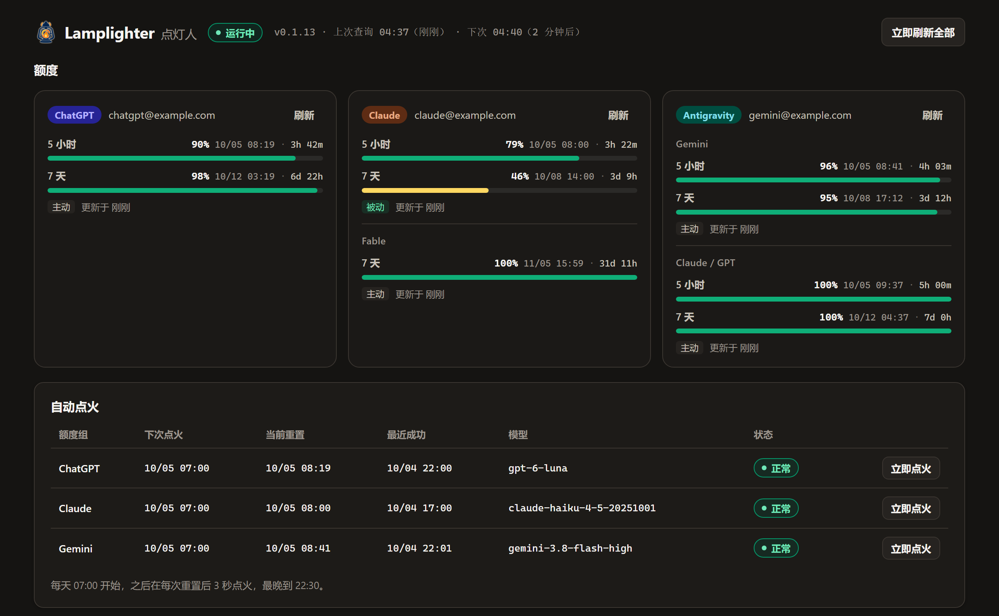
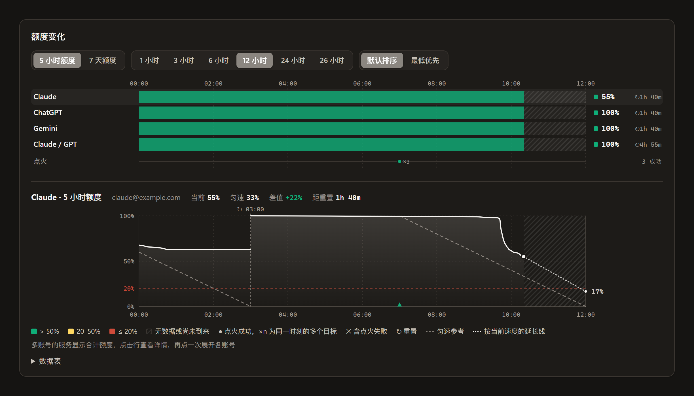
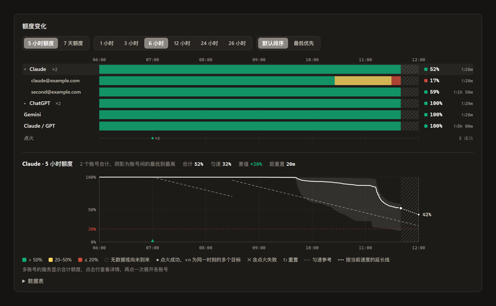

<p align="center"></p>

# Lamplighter

[中文](./README.md)

> When he lights his street lamp, it is as if he brought one more star to life, or one flower. — *The Little Prince*
>
> The lamplighter's planet turns once a minute, so every minute he lights his lamp and puts it out again, never missing a turn. Lamplighter does the same on schedule: each time a 5-hour quota window resets, it lights the next one.

Lamplighter is a plugin for [Magpie](https://github.com/yetone/magpie), published on npm as `magpie-lamplighter` and shown in Magpie as **Lamplighter**. It monitors the quota of the ChatGPT (Codex), Claude and Antigravity subscription accounts in Magpie, sends alerts through [Bark](https://github.com/Finb/Bark) or a generic webhook, and after each 5-hour quota window resets it sends one minimal request through Magpie so that the next window starts right away. Coding agents can read the quota over MCP.

The technical documents are in Chinese: [architecture](./docs/architecture.md) and [development](./docs/development.md).







## Features

- **Quota monitoring**: queries each account's quota from the vendor on a schedule, and also reads the quota Magpie records while it forwards requests.
- **Charts**: one quota card per account; the quota history chart shows each window's curve, an even-pace line, a projection at the current rate and ignition results, with a weighted total for services that have several accounts.
- **Notifications**: through Bark or a webhook (Feishu, ntfy, DingTalk, Telegram and others). Alerts when the remaining quota falls to 50%, 20%, 10% and when it runs out, and when an account's plan changes (for example when a membership expires). Optional recovery notices and pre-reset reminders; optional forwarding of [Did Codex Reset](https://didcodexreset.com/) reset signals.
- **Ignition** (off by default): from 07:00 each day, sends a minimal request 3 seconds after each 5-hour window resets, until 22:30. Requests go through the Magpie gateway, pinned to the account.
- **MCP**: coding agents can read the current quota, history and events, and refresh the quota.

| Service | Source in Magpie | Monitored | Ignition |
| --- | --- | --- | --- |
| ChatGPT / Codex | Magpie's Codex accounts | 5-hour, 7-day | Supported |
| Claude | Magpie's Claude accounts | 5-hour, 7-day, plus separately counted quotas such as Fable | Supported, 5-hour window only |
| Antigravity | Accounts of the agy-cli plugin (`@magpie-community/opencode-agy-cli-auth`) | Gemini, Claude / GPT and other quota groups | Off by default; once on, Gemini only by default |

Lamplighter monitors only the subscription accounts of the services `codex`, `claude` and `agy-cli` in Magpie. Magpie's built-in Antigravity accounts (service `antigravity`) have no credential Lamplighter can read and are not monitored; to monitor Antigravity, add the accounts through the agy-cli plugin. Accounts without a 5-hour window (such as ChatGPT Pro) are monitored for their other windows and are not ignited. API keys in Magpie have no quota windows and are not shown.

### Account names

In notifications and on the page, the quota group of ChatGPT accounts is named `GPT`, so its first letter differs from Claude's. When a service has several accounts, they are told apart by the last two characters of the email user name, as in `GPT#rk`. An account with a name shows the name instead, as in `GPT#main`: in Lamplighter's Settings view, fill in **Name** under **Accounts**; without one, the name the account was given in Magpie is used; the email or "email · workspace" (such as `a@b.com · Team`) that Magpie shows by default is no name. The name is kept in Lamplighter's settings and does not change the account's name in Magpie. Only its first line is used, cut at 20 characters; a service with one account shows the name too; when the name equals another account's name or email suffix in the same service, the email suffix is added after it. Events already recorded keep their old labels.

### Weights of several accounts

When a service has several accounts, the chart's total is the weighted average of each account's remaining quota. The weight says how many times the quota of the cheapest paid plan of that service the account has. The default weight follows the detected plan, whose name is shown at the bottom of the account card. ChatGPT's plan comes with the quota query; for Claude and Antigravity the account profile is read once a day per account, and again at once when the account's quota windows appear or disappear, for example when Gemini's 5-hour window disappears after Google AI Pro expires. When a read fails, the last plan read is kept; an account whose plan has never been read has weight 1. To set a weight by hand, fill in **Weight** under **Accounts** in the Settings view; decimals are allowed, and an empty field restores the plan default shown as a hint. Weights set by hand are saved in `account_weights` and take precedence. A weight other than 1 is shown after the account title, as in `×5`.

| Service | Plan | Default weight |
| --- | --- | --- |
| ChatGPT | Free, Go | 0.1 |
| ChatGPT | Plus, Business, Enterprise, Edu | 1 |
| ChatGPT | Pro $100, Business Premium | 5 |
| ChatGPT | Pro $200 | 10 |
| ChatGPT | Pro $500 | 25 |
| Claude | Pro, Team, Enterprise | 1 |
| Claude | Max 5x | 5 |
| Claude | Max 20x | 20 |
| Antigravity | Free, Pro, Ultra | 1 |

Unrecognized plans have a default weight of 1.

When an account's plan changes (for example when Google AI Pro expires or is renewed), the plugin sends a 🎫 notification such as `🎫 Antigravity · Plan Pro → Free`. The account's quota alerts then start over from the new plan's quota: it is recorded, not reported as a recovery or a drop. The first plan read is only recorded. Claude's plan is read once a day, so until the new plan is read, alerts still compare against the old plan's quota. When the plan changes later than the quota windows, or reading the plan has failed for more than an hour, alerts also compare against the old plan's quota and may send one wrong recovery or drop alert.

## Requirements

- Magpie v0.1.4634 or later. Earlier versions may lack the endpoint Lamplighter reads the account list from; v0.1.4479, for example, shows no accounts.
- The desktop app, `magpie web` and Docker deployments all work. The plugin carries its programs for Linux, macOS and Windows on amd64 and arm64, so nothing is downloaded at install time.
- To monitor Antigravity, install the agy-cli plugin in Magpie and add the accounts there.
- For notifications, an iPhone with Bark, or a service that receives webhooks.

## Installation

On Magpie's **Plugins** page, open **Discover**, enter `magpie-lamplighter` in the **Have one in mind?** field and click **Install**. Or on the command line:

```sh
magpie plugin add magpie-lamplighter
```

In a Docker deployment, run the command in the container, for example in a container named `magpie`:

```sh
docker exec magpie magpie plugin add magpie-lamplighter
```

When Magpie cannot read the community plugin list, this command fails; `magpie plugin add npm:magpie-lamplighter` installs the npm package by its name directly.

After installation, a **Lamplighter** page appears in the **Plugins** group of the sidebar. Opening it starts the plugin; the first query runs about 5 seconds after the plugin starts.

A new installation does not ignite. Before turning ignition on:

1. Set the time zone under **Time zone** in the Settings view and click **Save**. The ignition hours and the times on the page and in notifications follow it. Until a time zone is saved, the field shows the browser's time zone, which is not saved by itself.
2. Turn off Magpie's own warm-up; see [Conflict with Magpie's warm-up](#conflict-with-magpies-warm-up).
3. Tick **Enable ignition** under **Ignition** in the Settings view.

### Plugin options

The plugin has one option, `port`: the port of the internal listener, `8317` by default. Magpie's plugin page and tools reach Lamplighter through it. When another program holds the port (see [Ports](#ports)), open **Installed** on Magpie's **Plugins** page, click **Options** on Lamplighter's row and enter:

```json
{"port": 8320}
```

Or on the command line:

```sh
magpie plugin options magpie-lamplighter '{"port": 8320}'
```

### Updates

The plugin checks for a new version every 6 hours and whenever the management page opens. When one is out, an update icon linking to the release notes appears to the right of the version number in the page header. Update it on Magpie's **Plugins** page, or run `magpie plugin update`.

### Data directory

The plugin's configuration (`config.json`), state and quota history are kept in:

| Environment | Directory |
| --- | --- |
| Magpie's Docker image | `/config/state/lamplighter`, in the `/config` volume, kept across Magpie upgrades and container rebuilds |
| Linux, macOS | `$XDG_STATE_HOME/lamplighter`, or `~/.local/state/lamplighter` when `XDG_STATE_HOME` is not set |
| Windows | `%LOCALAPPDATA%\lamplighter` |

The full rules are in [进程和数据目录](./docs/architecture.md#进程和数据目录) (Chinese).

### Users of the CPA edition

Lamplighter started as a plugin for [CLIProxyAPI](https://github.com/router-for-me/CLIProxyAPI) (CPA), in [PosvdM/cpa-plugin-lamplighter](https://github.com/PosvdM/cpa-plugin-lamplighter). After moving to Magpie, install this plugin. It does not read the CPA edition's configuration or history, so the settings have to be entered again. When both run on the same machine, mind the [ports](#ports).

## Management page

The page opens in two ways:

- **In Magpie**: open **Lamplighter** in the **Plugins** group of the sidebar. This works in the desktop app and in `magpie web`, and needs no key. The page follows Magpie's language, light or dark theme, colors and fonts. Magpie's plugin pages cannot open links to other sites: **Appeal** in the events and the update icon beside the version show the address on click, to copy into a browser; the title does not link to GitHub.
- **Directly from outside**: turn on the public listener and reach it from other devices through a reverse proxy; see "Public access" below.

### Public access

The public listener lets other devices reach Lamplighter in a browser or over MCP. It is set under **Advanced** in the Settings view:

| Key | Default | Description |
| --- | --- | --- |
| `public_listen` | `127.0.0.1:8318` | Public listen address |
| `web_enabled` | `false` | Serve the page and API on the public listener, behind `admin_key` |
| `admin_key` | empty | Admin key; when `web_enabled` is turned on without one, the page generates one |
| `mcp_enabled` | `false` | Serve `/mcp` on the public listener; see [MCP](#mcp) |
| `mcp_key` | empty | MCP key; when `mcp_enabled` is turned on without one, the page generates one |

With both the page and MCP off, nothing listens. The two keys do not stand in for each other: the admin key cannot reach `/mcp`, and the MCP key cannot reach the page and API. The two keys must differ: the page refuses to save equal keys, and when equal keys are written into `config.json` by hand, the public listener serves neither the page and API nor `/mcp`, and the top of the page shows why.

The first time the page is opened through the public address, it asks for the admin key ("Management key required") and keeps it in the browser. Page preferences such as blurring accounts are also kept per browser.

Listening on the public internet directly is not recommended. Keep the public listener on loopback, let a reverse proxy on the same host terminate TLS, and add a firewall or allow-list as needed. The proxy must pass the `Authorization` and `MCP-Protocol-Version` headers; `/mcp` refuses browser requests whose `Origin` is not local, which ordinary MCP agents do not send.

In a Docker deployment the public listener is inside the container. Set `public_listen` to `0.0.0.0:8318`, publish the port when creating the container (for example `-p 127.0.0.1:8318:8318`), and forward to it from a reverse proxy on the host.

Nginx example (replace the domain and certificate paths):

```nginx
server {
    listen 443 ssl;
    server_name quotas.example.com;
    ssl_certificate /etc/letsencrypt/live/quotas.example.com/fullchain.pem;
    ssl_certificate_key /etc/letsencrypt/live/quotas.example.com/privkey.pem;
    location / {
        proxy_pass http://127.0.0.1:8318;
        proxy_set_header Authorization $http_authorization;
        proxy_set_header MCP-Protocol-Version $http_mcp_protocol_version;
        proxy_read_timeout 190s;
    }
}
```

Caddy example (the domain resolves to the proxy, and Caddy obtains the HTTPS certificate):

```caddyfile
quotas.example.com {
    reverse_proxy 127.0.0.1:8318 {
        transport http {
            response_header_timeout 190s
        }
    }
}
```

Authentication and listener details are in [对外监听](./docs/architecture.md#对外监听) (Chinese).

### Page contents

**Quota | Settings** at the top switches views, and the browser remembers the last one. The Quota view contains:

- each account's quota windows, reset times (with the weekday), data source and plan, with a refresh per account;
- times in the time zone set in the Settings view; without one, times are in the browser's time zone and the top of the Quota view says so: the ignition hours and the times in notifications then follow the server's time zone;
- five colors shared by the quota bars and the chart: **Full** at a raw 100%, **Empty** at 0%, and **High**, **Medium** and **Low** in between, split by the first two alert thresholds; 99.6% is not colored as full even though it shows as 100%;
- the next ignition time and current reset time of each quota group (both with the weekday), the latest result and the failure-protection state, with **Ignite now**; this part is hidden while ignition is off;
- the quota history chart:
  - First pick the 5-hour or the 7-day quota. The 5-hour quota offers 1, 3, 6, 12, 24 and 26 hours (6 by default); the 7-day quota offers 1, 4, 8 and 15 days, 1 month (from this day last month) and 36 days (8 days by default). Windows of other lengths appear only on the account cards. With `remember_chart_filters` on, the page remembers the last choice.
  - 1 and 3 hours, and 1 and 4 days, end at the current time. Longer ranges end at the reset time of the selected row's current window; 6 hours, for example, shows the current 5-hour window and the last hour of the previous one. The part after now is hatched.
  - The upper part has one strip per service, colored like the quota bars by the lowest reading in each cycle. Rows follow the order of the account cards by default, or can be sorted by lowest remaining; a service with several accounts shows a weighted total, which expands into its accounts on click. A window an account no longer reports is marked **Inactive** and kept until its last sample leaves the range.
  - The lower part is the selected row's curve, marking resets and ignition results, with an even-pace line that falls linearly from 100% to 0% at the scheduled reset over a 5-hour or 7-day cycle. A curve above the line means slower use than even pace. Above the curve are the current remaining, the even-pace value at this moment and the difference.
  - When the right end is the reset time, a projection is drawn from now: if the quota runs out first, the time axis marks when; if the reset comes first, the remaining quota at the reset is labeled on the right. The 5-hour quota is projected at the current rate, so the run-out time is early in the first minutes of heavy use; the 7-day quota is projected at the cycle's daily average, which is less accurate in the first day or two of a cycle.
  - The page reads the status every 30 seconds and updates the chart when new data arrives; while the mouse is over the chart, the update waits until it leaves.
  - When an account has several quota groups, such as **Gemini** and **Claude / GPT** of Antigravity, the chart, its data table, the ignition table and the events put the service before the group, as in **Antigravity · Claude / GPT**. The account cards, which show the groups under the service badge, do not.
- recent events, in columns for time, type, quota group and details; the quota group column is as wide as its longest name. A notification triggered by an event is marked at the end of that event's row as **Notified** or **Notification failed**. 5-hour resets are hidden by default; tick **Show 5-hour resets** to see them.

How the chart is computed is in [页面功能](./docs/architecture.md#页面功能) (Chinese).

The eye buttons in the page header, the card area header and the detail chart header share one **Blur accounts** / **Show accounts** switch. Blurring covers account names, emails and the fields under **Accounts**, and old account names kept in events and the history chart; upstream errors and other text that may name an account are blurred whole. The state is kept in the browser, separately for each computer and browser. Blurring only affects the display and does not remove anything from the API or the page.

The camera buttons on each account card, the card area header and the detail chart header copy one card, all cards or the detail chart as a PNG image. The image keeps the current theme and blur state and leaves out the buttons. In Magpie, the image is handed to Magpie, which puts it on the clipboard; when the page is opened on its own, the browser must support image clipboard and grant clipboard permission in a secure context such as HTTPS or localhost.

The Settings view has **Accounts**, **Notification channels**, **Alert rules**, **Time zone**, **Ignition**, **Services** and **Advanced**. Switches and checkboxes save on click; text and numbers save when the field loses focus or on Enter. The result is shown to the right of the section title: **Saved; waiting to take effect**, then **In effect** once the plugin confirms, or **Not confirmed in effect** after 15 seconds. When a save fails, the title shows the field and the reason, the field is outlined in red and the draft is kept. Under **Accounts** you can set names and weights and drag the handles to reorder accounts (saved as `account_order`); Esc cancels a drag. **Send test** under **Notification channels** sends to every configured channel once the settings are in effect and shows each result.

## How quota is read

**Active queries**: every 5 minutes by default, at fixed minutes `00 / 05 / 10 / ... / 55` of each hour. In addition, 30 seconds before and 30 seconds after each quota window resets, the plugin queries that account once more: the first records the last remaining quota of the cycle, the second confirms the new cycle and sends the recovery notice promptly. A query is skipped when a newer reading already arrived. Queries go straight to the vendor's quota endpoint, not through the Magpie gateway and not through Claude Code.

**Magpie's quota records**: Magpie records each account's quota while it forwards requests, and the plugin reads them every 60 seconds without sending anything to the vendor. Codex and Claude have such records; Antigravity is only queried actively. When an account has had a new reading within 60 seconds before a scheduled query, that round skips the account; one account is skipped for at most 30 minutes in a row.

**Credentials**: the plugin reads each account's token from Magpie's configuration directory and uses it only in memory. Claude and Codex tokens are read and never refreshed: these services replace the refresh token on every refresh, so a refresh by the plugin would invalidate the token held by Magpie or the proxied CLI and sign the account out. While such a token has expired and Magpie has not refreshed it yet, the plugin does not query the vendor and uses Magpie's latest recorded reading instead; a manual refresh (the page's refresh buttons or MCP's `refresh_quotas`) first asks Magpie to read that account's quota again. When the refresh of one account fails, the page and `refresh_quotas` give the reason, such as the account being switched off in Magpie, Magpie not having the account, or the Magpie gateway being unavailable. When Magpie brought no new reading this time, the page shows Magpie's older reading and the refresh still fails, with a reason that starts with "Magpie 这次没有读到新额度"; `refresh_quotas` does not pass on upstream error texts, and for other errors points to `list_quotas` for each account's state. Antigravity tokens are refreshed by the plugin in memory and never written back. The rules are in [凭证](./docs/architecture.md#凭证) and [额度记录](./docs/architecture.md#额度记录) (Chinese).

**Network egress**: active queries use the same egress as Magpie's requests for the same account: the proxy Magpie sets for that account or service, then Magpie's global proxy, then the system proxy Magpie uses, and a direct connection when there is none. When the proxy cannot be parsed, the plugin skips the query instead of connecting directly. See [网络出口](./docs/architecture.md#网络出口) (Chinese).

Claude and Codex quotas are whole percentages; Antigravity's have decimals. When a window disappears on a plan upgrade and reappears after a downgrade, its first reading only sets a new alert baseline, without a recovery notice or pre-reset reminder; a window that disappears is not notified, and the history keeps it.

## Ignition

A 5-hour quota window starts counting from the first request after a reset. If nobody uses the account after the reset, the window does not start. With ignition on, Lamplighter sends a request right after each reset so that windows roll on back to back. The rules:

- Times follow the time zone set in the Settings view, not the time zone of the server Magpie runs on. Without one, the time zone of the system the program runs on is used, which is UTC in Magpie's Docker image; the page then shows times in the browser's time zone, and the top of the Quota view says no time zone is set.
- The first ignition each day is at `07:00`, then 3 seconds after each reset, until `22:30`. A reset later than that waits until 07:00 the next day.
- Requests go through the Magpie gateway, pinned to the account by a request header, so the gateway does not switch to another account. Claude requests are forwarded by Claude Code inside Magpie and carry Claude Code's own system prompt, so they use more input tokens than a direct request.
- The request only asks the model to reply `OK` and carries no tools. The request is closed 2 seconds after the first output; the request of each candidate model takes 2 minutes at most from sending it to the end; when the gateway answers an error status, reading the error body may take up to 10 more seconds. Moving on to the next candidate and the confirmation that follows take extra time, so one ignition can take longer.
- The ignition model is chosen automatically: the newest Luna for ChatGPT, the newest Haiku for Claude, and the newest Flash for Antigravity's Gemini group. Once Magpie lists a new model, the next ignition uses it; when the account cannot use the model, that ignition moves on to the next candidate, and a model the vendor refused is not tried again for 24 hours. A model can also be set in the configuration.
- An ignition counts as successful only once the plugin sees the 5-hour window with a fixed reset time in the future. The Magpie gateway does not forward Codex's quota response headers, so Codex and Antigravity ignitions are confirmed by the active queries that follow: several checks whose waits add up to about 75 seconds, plus the time each query takes.

The model, reply, usage and duration of each ignition are written to Magpie's log; see [调用日志](./docs/architecture.md#调用日志) (Chinese).

### Conflict with Magpie's warm-up

Magpie's own warm-up (the built-in plugin **Warm-up and check-in**) also sends requests after a window resets or at set times, starting the 5-hour windows of Codex and Claude. Running it together with Lamplighter's ignition ignites twice. When Lamplighter's ignition is on and Magpie also warms up the 5-hour window of the same accounts, the top of the page lists those accounts; turn their warm-up off in Magpie. Warm-up only at 7-day resets does not conflict.

### Failure protection

The retry and pause rules below apply to automatic ignition. When **Ignite now** fails, the page shows the error and an event is recorded; it does not retry, does not count as a failure and leaves the automatic schedule unchanged. A success is recorded as usual.

- When the credential is invalid (401 and similar) or the account is suspended (for example Google returns `TOS_VIOLATION`), automatic ignition stops for that account and does not retry each day, and a 🔑 or ⛔ notification is sent once (the suspension notice includes the appeal link). Signing in again in Magpie resumes it; a successful **Ignite now** does too. Quota queries that keep failing authentication (3 times in a row over at least 30 minutes) or find the account suspended raise the same alert; one problem is alerted once, also across restarts. When it clears, ✅ credential restored is sent.
- A vendor rate limit (429), an unavailable model, or a successful request that does not start the window pauses that quota group until 07:00 the next day and sends one notification; for rate limits it is ⏳ rate limited. The notification gives only the first sentence of the upstream error; the full error is in the event details on the page.
- Network and server errors are retried after 5 and then 15 minutes; a third failure also pauses until the next day.
- After an account is rate-limited or runs out of quota, Magpie rests it until the vendor's reset time. When an ignition hits such a rest that ends within 10 minutes, it retries once the rest ends and does not count as a failure.
- When the 7-day quota (or another non-5-hour window) of the same account is used up, automatic ignition of that quota group stops until that window resets and a query sees the quota back; the page shows "7-day quota used up". **Ignite now** is not affected.

The classification is in [失败分类和保护](./docs/architecture.md#失败分类和保护) (Chinese).

## Notification example

Notifications use the page language from the last time the management page was opened (Chinese or English, following Magpie), or Chinese if it has never been opened.

```text
🟡 Claude · 7d 48% | 03d

5h: 96% | 04h | 10/04 13:50
7d: 48% | 03d | 10/07 14:00
```

Title icons: 🟡 remaining fell to the first threshold (50% by default), 🔴 to the second (20% by default) or lower, ✅ quota recovered, ⏰ reset reminder, 🎫 plan changed, 🔑 credential invalid, ⛔ account suspended, ⏳ rate limited, ✅ credential restored, ⚠️ ignition paused or another problem that needs attention. Each body line is: window, remaining quota, time until reset, reset time. The first time a quota window is seen, its state is only recorded, not notified.

## Configuration

The configuration is kept in `config.json` in the [data directory](#data-directory). It is normally changed in the Settings view of the management page and takes effect on save, without a restart. The plugin reads the file only when it starts and afterwards overwrites it with what the page saves. To edit it by hand, switch Lamplighter off on Magpie's **Plugins** page first, edit the file, switch it on again, then open the page once.

| Key | Default | Description |
| --- | --- | --- |
| `bark_url` | empty | Bark push URL, up to the device key; empty means no Bark notifications |
| `bark_group` | `Magpie` | Bark notification group |
| `bark_icon` | Lamplighter icon | Notification icon |
| `webhook` | empty | Generic webhook; see [Webhook](#webhook) |
| `notice_threshold` | `50` | First alert threshold (remaining percent) |
| `low_threshold` | `20` | Second alert threshold |
| `critical_threshold` | `10` | Third alert threshold |
| `recovery_notify` | 5-hour `after_exhausted`, 7-day `all` | Notify when the quota recovers; see below |
| `reset_reminder` | 5-hour `off`, 7-day `has_remaining` | Remind before a reset; see below |
| `timezone` | empty | Time zone for displayed times and the ignition hours, an IANA name such as `Asia/Shanghai`; empty means ignition and notifications use the time zone of the system the program runs on (UTC in Magpie's Docker image), and the page shows times in the browser's time zone. To follow the system's time zone, leave it empty; `Local` counts as an invalid name. Checked on save, and an invalid name is not saved; an invalid name written by hand is logged as a warning at startup and treated as empty |
| `timezone_offset_hours` | empty | A fixed UTC offset such as `8`; used only when `timezone` is empty |
| `poll_interval_seconds` | `300` | Active query interval, at least 60 |
| `request_timeout_seconds` | `20` | Timeout of quota queries, notifications and other HTTP requests, 5 to 120; does not limit ignition |
| `passive_skip_seconds` | `60` | Skip the active query when Magpie has a new reading this many seconds before it; `0` never skips |
| `passive_skip_max_minutes` | `30` | How many minutes one account may be skipped in a row |
| `history_retention_days` | `40` | Days of quota history to keep |
| `remember_chart_filters` | `false` | Remember the quota window, range and sort last chosen in the quota history chart, in this browser |
| `account_names` | empty | Account names, keyed by the account's identifier in Magpie (such as `codex/<id>`) |
| `account_weights` | empty | Weight of each account in a multi-account total, keyed the same way, a number above 0; accounts without one use the plan default |
| `account_order` | empty | Account order, as a list of account identifiers; accounts not listed follow in the default order |
| `public_listen`, `web_enabled`, `admin_key`, `mcp_enabled`, `mcp_key` | | See [Public access](#public-access) |
| `config_token` | empty | A confirmation token the page generates on each save; no need to set it |

The thresholds are adjusted so that `100 ≥ notice_threshold ≥ low_threshold ≥ critical_threshold ≥ 0`; a later threshold cannot be above an earlier one.

With both `bark_url` and `webhook.url` empty, notifications are off: nothing is sent and no delivery failure is recorded. Quota alerts from that time are not sent later when an address is filled in.

Recovery notices and pre-reset reminders are set per window: `five_hour` for the 5-hour window, `seven_day` for the 7-day window:

| Key | Values | Description |
| --- | --- | --- |
| `recovery_notify` | `off`, `all`, `after_exhausted` | `all`: notify on every reset; `after_exhausted`: after the window was used up, notify once at the next reset |
| `reset_reminder` | `off`, `all`, `has_remaining` | Remind 1 hour before a 5-hour window resets and 1 day before a 7-day window resets; `has_remaining`: only while the remaining quota is above `critical_threshold` |

The first line of a recovery notice is the remaining quota at the end of the previous cycle. It comes from the active query 30 seconds before the reset, so use in the last 30 seconds is not counted. Without a reading in the last 15 minutes before the reset, the line is left out. A cycle that was never used (still 100% before the reset) is not notified.

Ignition settings are under `ignition`:

| Key | Default | Description |
| --- | --- | --- |
| `enabled` | `false` | Ignite automatically |
| `start_hour` | `7` | Hour of the first ignition each day |
| `end_hour` | `22` | Hour after which ignition stops each day |
| `end_grace_minutes` | `30` | Minutes past `end_hour` still allowed |
| `grace_seconds` | `3` | Seconds to wait after a reset before igniting |
| `failure_retry_seconds` | `300` | Wait before the first retry after a temporary error |
| `failure_backoff_multiplier` | `3` | Factor applied to the wait on each retry |
| `max_transient_failures` | `3` | Temporary errors after which ignition pauses until the next day |
| `post_success_hold_seconds` | `60` | Minimum wait after a successful ignition before another |

Per-service settings are under `providers`, keyed `codex`, `claude` and `antigravity`:

| Key | Description |
| --- | --- |
| `monitor` | Monitor this service; on by default. A service that is not monitored is not ignited either |
| `ignite` | Ignite automatically; on by default for `codex` and `claude`, off for `antigravity` |
| `model` | Ignition model, chosen automatically when empty; it must be in Magpie's model list for that service, as a model name or a full ID with the service prefix, such as `agy-cli/gemini-3-flash` |
| `groups` | Antigravity only: quota groups that may be ignited, `["Gemini"]` by default; an empty list `[]` ignites none, and the default applies when the key is absent |
| `models` | Antigravity only: a model per quota group, such as `{"Gemini": "gemini-3-flash"}` |

`codex_reset_updates` controls Did Codex Reset forwarding: `enabled` (default `false`), `poll_seconds` (default `300`, at least 300) and `notify_current_pending` (default `true`: the first time it is turned on, send the schedule still pending). Only schedules not yet due and completions from the last 48 hours are forwarded; when several posts announce the same schedule, another notice is sent only when the confidence, time or scope changes. Did Codex Reset is a third-party monitor, and its signals are not confirmed by OpenAI.

Example:

```json
{
  "timezone": "Asia/Shanghai",
  "bark_url": "https://api.day.app/your_device_key",
  "ignition": {"enabled": true, "start_hour": 7, "end_hour": 22},
  "providers": {
    "antigravity": {"ignite": true, "groups": ["Gemini"]}
  },
  "codex_reset_updates": {"enabled": true}
}
```

Objects such as `ignition` and `providers` are saved whole per top-level key; the page builds on the object already saved.

## MCP

MCP lets coding agents read the quota. There are two ways in:

| Way | Address | Authentication | Tool names |
| --- | --- | --- | --- |
| Magpie's plugin tools | `/mcp/magpie/tools/magpie-lamplighter` on the Magpie gateway | Same as the Magpie gateway | Prefixed with `magpie-lamplighter_`, such as `magpie-lamplighter_list_quotas` |
| Public listener | `/mcp` on the public listener, `http://127.0.0.1:8318/mcp` by default | `mcp_key` | No prefix |

### Magpie's plugin tools

Once the plugin is on, Magpie serves its tools as an MCP server; nothing needs to be turned on in Lamplighter. On Magpie's **Plugins** page, Lamplighter's row lists the tools and can copy the MCP address. Magpie also adds a server named `magpie-lamplighter` to the MCP servers in its **Library**, which agents get directly while the MCP router is on. With the gateway on its default `127.0.0.1:3425`, the address is:

```text
http://127.0.0.1:3425/mcp/magpie/tools/magpie-lamplighter
```

Requests from the same machine need no key; from other machines or from outside a Docker container they need a Magpie gateway key. Magpie gives each tool call at most 55 seconds, so `refresh_quotas` waits about 50 seconds at most this way.

### /mcp on the public listener

Under **Advanced** in the Settings view, tick **Enable the MCP endpoint**; without a key, the page generates one in the same save, and a new key can also be generated separately. The same section gives client configurations for Claude Code, generic JSON and mcp-remote. For remote use, go through an HTTPS reverse proxy; see [Public access](#public-access).

The endpoint uses Streamable HTTP with protocol versions `2025-03-26` and `2025-06-18`, and returns JSON only, without SSE. Each server instance runs at most 4 tool calls at a time; beyond that it answers at once with a JSON-RPC `-32000` busy error, and the call can be retried later. Query tools time out after 10 seconds and `refresh_quotas` after 180 seconds. Protocol details are in [MCP](./docs/architecture.md#mcp) (Chinese).

In the examples below, `<key>` is the MCP key; for remote connections, use the HTTPS address instead.

Claude Code:

```sh
claude mcp add --transport http lamplighter http://127.0.0.1:8318/mcp --header "Authorization: Bearer <key>"
```

Codex CLI (key provided through an environment variable):

```sh
export LAMPLIGHTER_MCP_KEY='<key>'
codex mcp add lamplighter --url http://127.0.0.1:8318/mcp --bearer-token-env-var LAMPLIGHTER_MCP_KEY
```

Generic client configuration (check your client's documentation for the exact fields):

```json
{"mcpServers":{"lamplighter":{"type":"http","url":"http://127.0.0.1:8318/mcp","headers":{"Authorization":"Bearer <key>"}}}}
```

Clients that support only stdio can connect through `mcp-remote`:

```sh
npx mcp-remote http://127.0.0.1:8318/mcp --header "Authorization: Bearer <key>"
```

### Tools

| Tool | Purpose |
| --- | --- |
| `list_quotas(provider?, account?, model?)` | Current windows, each account's plan and weight, weighted remaining, the account that runs out first, reset and projected run-out times, hourly use, 7-day even-pace budget, data source and freshness, invalid credentials, suspended accounts and the next ignition time |
| `get_quota_history(provider?, account?, window?, range?)` | Quota history, including windows that have disappeared; at most 200 points per series and 2000 per call |
| `refresh_quotas(account?)` | Active query; at most once every 60 seconds overall, returning the seconds to wait when called too soon; on failure returns `ok: false` and the reason |
| `get_quota_events(since?, limit?)` | Recent resets, exhaustion, ignition successes and failures, invalid credentials, suspended accounts, rate limits and restored credentials; `since` is an RFC 3339 time with time zone, `limit` an integer from 1 to 100 |

Account identifiers in tool results use the account name, with emails in it masked; without a name they are `***` plus the last two characters of the email user name, such as `***rk`. Identifiers that are equal after masking get `#1`, `#2` suffixes. Tools never return full emails, whatever the page's blur switch says. The `account` argument takes a returned identifier, the base identifier before the suffix, the original account name or the full email, all matched exactly; `refresh_quotas` needs a single match.

The plugin waits about 5 seconds after it starts before the first round of queries. Until that round completes, the reading tools return `ready: false`, `state: "starting"` and `retry_after_seconds: 30`, without data. Times include an ISO time with time zone and a relative time. Projections depend on the rate of use and are not guaranteed. A `model` query returns candidate quota groups marked `certain: false`: Magpie picks the account for a real request by its own rules, and the plugin cannot say which one it will be. Field meanings are in [工具数据](./docs/architecture.md#工具数据) (Chinese).

## Webhook

Besides Bark, a webhook can send notifications to Feishu, ntfy, DingTalk, Telegram and other services, or to your own program. With both channels configured, every notification goes to both; it counts as delivered when either succeeds and is not retried, and the failed channel is recorded as a delivery failure in the events.

| Key | Default | Description |
| --- | --- | --- |
| `url` | empty | Request URL; empty disables the webhook |
| `method` | `POST` | `GET`, `POST` or `PUT` |
| `headers` | empty | Request headers, such as `Authorization: Bearer <token>` |
| `body` | empty | Request body; empty sends the built-in JSON message. Not allowed with `GET` |
| `success_json` | empty | Success condition: these top-level fields of the JSON response must equal the given values, such as `{"code": 0}`; empty only requires an HTTP 2xx status |

The URL, headers and body may contain placeholders:

| Placeholder | Content |
| --- | --- |
| `{{title}}` | Notification title |
| `{{body}}` | Notification body |
| `{{text}}` | Title and body separated by a newline |
| `{{url}}` | Link: the history page for Did Codex Reset notices, the https appeal link for suspension notices, empty otherwise |
| `{{priority}}` | `high` when the quota falls to the third threshold or runs out, the plan changes, ignition pauses, the credential is invalid, the account is suspended or rate-limited; `normal` otherwise |
| `{{kind}}` | Notification type: `quota` quota drop, `recovery` quota recovered, `reminder` reset reminder, `plan` plan changed, `circuit` ignition paused, `credential` credential invalid, `suspended` account suspended, `rate_limited` rate limited, `credential_ok` credential restored, `codex_reset` Did Codex Reset, `test` test notification |
| `{{label}}` | Quota group, such as `GPT#rk` or `GPT#main`; empty for notifications not tied to a quota group |
| `{{time}}` | Send time in RFC 3339, in the plugin's time zone |

Placeholders are escaped for where they appear: URL-encoded in the URL; JSON-string-escaped in a JSON body, so they go inside quotes; form-encoded in a form body; newlines turned into spaces in headers. Without a `Content-Type` header, a body that is JSON (placeholders inside quotes) is sent as JSON, and anything else as plain text.

The JSON sent when `body` is empty:

```json
{"source":"lamplighter","kind":"quota","title":"🔴 GPT#rk · 5h 8% | 03h","body":"5h: 8% | 03h | 10/10 19:00\n7d: 60% | 04d | 10/14 09:00","text":"…","url":"","priority":"high","label":"GPT#rk","time":"2026-10-10T16:00:00+08:00"}
```

Formats for common services follow. They are based on each service's documentation and have not all been tested.

| Service | `url` | `body` | `success_json` |
| --- | --- | --- | --- |
| ntfy | `https://ntfy.sh/` | `{"topic":"<topic>","title":"{{title}}","message":"{{body}}"}` | Not needed |
| Feishu | `https://open.feishu.cn/open-apis/bot/v2/hook/<token>` | `{"msg_type":"text","content":{"text":"{{text}}"}}` | `{"code":0}` |
| DingTalk | `https://oapi.dingtalk.com/robot/send?access_token=<token>` | `{"msgtype":"text","text":{"content":"{{text}}"}}` | `{"errcode":0}` |
| WeCom | `https://qyapi.weixin.qq.com/cgi-bin/webhook/send?key=<key>` | `{"msgtype":"text","text":{"content":"{{text}}"}}` | `{"errcode":0}` |
| Discord | `https://discord.com/api/webhooks/<id>/<token>` | `{"content":"{{text}}"}` | Not needed |
| Slack | `https://hooks.slack.com/services/<path>` | `{"text":"{{text}}"}` | Not needed |
| Telegram | `https://api.telegram.org/bot<token>/sendMessage` | `{"chat_id":"<chat_id>","text":"{{text}}"}` | Not needed |

Under **Notification channels** in the Settings view, enter the `url` above in **Webhook URL**, the `body` in **Body** and the `success_json` in **Success condition (optional)**.

- Feishu, DingTalk and WeCom return HTTP 200 even when sending fails, with the error code in the response, so set a success condition; otherwise failed notifications count as sent.
- The plugin does not support the signature verification of Feishu and DingTalk bots. Use a custom keyword or an IP allow-list in the bot's security settings instead; with a keyword, put it in the body, for example `"text":"Lamplighter {{text}}"`.
- **Send test** shows the result of each channel and the start of the webhook response. Without a success condition, the page notes that only the HTTP status was checked and that you should confirm receipt in the client.
- When the webhook settings are wrong (for example a misspelled placeholder), the webhook is not enabled and the top of the page shows why; the other settings take effect as usual.

## Ports

| Listener | Default address | How to change |
| --- | --- | --- |
| Internal listener | `127.0.0.1:8317` | Plugin option `port`; see [Plugin options](#plugin-options) |
| Public listener | `127.0.0.1:8318`, off by default | Configuration key `public_listen` |

These are the default ports of CPA and of the CPA edition of Lamplighter. When those run on the same machine as Magpie, change `port` or `public_listen`. When Magpie runs in Docker, in a network namespace of its own, they do not conflict.

The internal listener serves Magpie only, needs no key and accepts only requests whose Host is a loopback address; API requests from a browser must come from Lamplighter's own page. The plugin starts the program with `-listen 127.0.0.1:<port>`. When the program is run directly, `-listen` must be a loopback address; with any other address the program exits with an error. Use [Public access](#public-access) from other machines.

## Known limitations

- Lamplighter runs with Magpie's plugin host. Magpie starts the plugin host when it launches and when a plugin is called. After a plugin is installed or updated or its options change, and after the plugin host is replaced for using too much memory, Lamplighter stops with the old host and starts again only at the next plugin call; until then it does not query, ignite or notify. Opening Lamplighter's page, calling its tools, or a request served by a plugin such as agy-cli starts the plugin host, so open the page once after installing the plugin or changing its options. Running in the background needs support from Magpie, which has been requested upstream ([yetone/magpie#7114](https://github.com/yetone/magpie/issues/7114)).
- On macOS and Windows, the credential of the first Antigravity account that agy signed in to by itself is in the system keychain. Lamplighter does not read the keychain and cannot confirm which account agy is signed in to, so the account is neither queried nor ignited, and the status shows why. Add the account again in Magpie with "Add another Google account" to query and ignite it.
- On Linux, the first Antigravity account that agy signed in to by itself is read from agy's default credential file, which holds whichever account agy is signed in to now. When agy has signed in to another Google account, or the file or Magpie does not record the account's email, the identity does not match: the account is neither queried nor ignited, and the status shows why. When agy has signed in to another account, sign agy back in to this one. When Magpie has no email for the account, signing in to agy again does not add it (the email is recorded only when the account is signed in through Magpie); add the account again in Magpie with "Add another Google account". Do the same when the file does not record the account.
- When an Antigravity credential's `auth_method` is neither empty nor `consumer` (a personal Google account), the quota query shows an error.
- When Magpie's `MAGPIE_ADDR` is a LAN address, the gateway requires a gateway key and Lamplighter cannot reach it.

## Security and risk

- The plugin reads the tokens Magpie keeps only in memory, to query quotas, and never writes them to logs or disk.
- Before an error text is written to the log, the state, the events and the history, or shown on the page, in the API, over MCP and in notifications, emails keep only the last two characters of the user name (such as `***rk`), URLs lose their query and user info, and token-like strings become an ellipsis. The rules are in [错误文本的脱敏](./docs/architecture.md#错误文本的脱敏) (Chinese).
- `bark_url`, `webhook`, `admin_key` and `mcp_key` are stored in plain text in `config.json` (mode 600), readable by anyone who can reach the internal listener or holds the admin key.
- The internal listener needs no key, so any program on the same machine (in the same container for Docker) can reach it; other web pages in a browser cannot call its API.
- Each service has its own restrictions on third-party tools using subscription accounts. Using accounts through Magpie, sending scheduled ignition requests and querying quota may all put an account at risk; judge for yourself.

## Development

The plugin's structure, data flow and design constraints are in the [architecture document](./docs/architecture.md); building, testing and releasing are in the [development document](./docs/development.md). Both are in Chinese.

## License

[AGPL-3.0-or-later](./LICENSE). If you distribute a modified version, or provide a modified version to others over a network, you must publish its source code under the same license.
